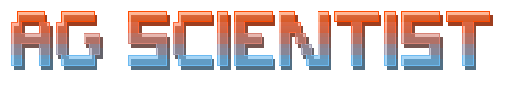

<p align="center">

</p>

<h1 align="center">
  The Agentic Scientist<br>
  <sub>Orchestrating Coding Agents for Automated Scientific (Co-)Discovery</sub>
</h1>

<p align="center">
  <i>Turn a task description into experiments, ablations, and a paper, driven by coding agents.</i>
</p>

<p align="center">
  <a href="https://arxiv.org/abs/2610.18933"></a>
  <a href="https://arxiv.org/pdf/2610.18933"></a>
  <a href="LICENSE"></a>
</p>

Agentic Scientist treats coding agents as AI scientists. Starting from a
`task.md`, the agents propose ideas, run experiments, evaluate outcomes against
the task rubric, and iterate toward stronger programs. The pipeline then runs
baselines and ablations, a sealed final evaluation, post-hoc analyses, and
writes the paper, with every stage kept under one run directory.

## Install

The recommended setup runs every agent phase inside Docker, which is the
default for `agsci run`. Install [Docker](https://docs.docker.com/get-docker/),
then build the agent image:

```bash
docker build -t agentic-scientist/agent-cli:latest -f src/docker/agent-cli/Dockerfile .
```

If the build cannot reach package mirrors, add `--network=host` to the
`docker build` command.

> **Security note** — Agentic Scientist launches coding agents with full tool
> permissions (Headless `--allow yolo`). They can run arbitrary commands and
> inherit the API keys you give them, and the task files and papers they read
> steer what they do. Keep runs inside the Docker image rather than on your
> workstation, only run tasks and sources you trust, and review run directories
> before sharing them: agent logs can echo document contents and paths.

### Prerequisites

- **Python ≥ 3.11 with [uv](https://docs.astral.sh/uv/)**. `uv sync` creates
  `.venv` and installs the `agsci` command:

  ```bash
  curl -LsSf https://astral.sh/uv/install.sh | sh
  uv sync
  source .venv/bin/activate
  ```

- **API keys** in a `.env` file at the repo root (`ANTHROPIC_API_KEY`,
  `OPENAI_API_KEY`, `GEMINI_API_KEY`, ... whichever your agent
  needs). The pipeline mounts it into the agent containers. Never commit it.
- **Agent CLIs** are already inside the image. For native (non-containerized)
  runs, install the CLI of the agent you use plus Git and Node.js; versions and
  commands are in [docs/install.md](docs/install.md).
- **GPUs** are required only by the GPU task presets. The pipeline discovers
  them through `nvidia-smi` and refuses to start compute phases unless the
  visible GPUs match the preset.
- **Autoillustrate** (optional) is built into the image for concept figures.
  To use it directly on the host, follow the single-command install in the
  [Autoillustrate README](https://github.com/SakanaAI/Autoillustrate#readme).

Run `agsci doctor` to check the host, or `agsci doctor examples/<task> preset=<task>`
to check everything one specific run needs (CLI, credentials, image, GPUs, task
scaffold).

## Quickstart

Point `agsci run` at a task directory. This runs the default six phases
(task drafting → investigation → ablations → final evaluation → post-hoc analysis
→ paper) on the CPU-only circle-packing example:

```bash
agsci run examples/circpack
```

Add `--dry-run` to validate the configuration and preview the exact commands
without running anything. Every option is a Hydra `key=value` override; `agsci
run --help` lists them all.

> **Note** — Agentic Scientist drives `claude`, `codex`, `cursor`, `opencode`,
> `gemini`, and `pi` through
> [Headless CLI](https://github.com/RobertTLange/headless-cli), so the same
> experiment can be repeated across agents and models: pick one with
> `agent.name=<agent> agent.model=<model>`.

Task drafting only writes a scaffold when the task directory has none; every
shipped example already includes its evaluator, so the drafting phase only
snapshots it and the investigation phase builds and validates the task runtime.
Drafting a task from a bare research brief is experimental (see
[example 8](#8-draft-a-task-from-a-research-brief-experimental)).

### What you get

Each run writes one predictable envelope under `results/`:

```text
results/<task>/<agent>/<run_id>/
├── task_drafting/ # drafting logs and validation audit
├── task/          # immutable run-local task snapshot
├── investigation/  # ideas, attempts, winner, and optimizer memory
├── ablations/     # baselines and ablations
├── final_evaluation/         # sealed final evaluation
├── posthoc/       # post-hoc analyses
└── paper/         # manuscript, PDF, manifest, and optional AI reviews
```

Investigation plus the task snapshot is enough to write a paper; the other
phases add evidence when available and are reported as degraded when they fail.
Browse any run in the browser with `agsci inspect start`
(`http://127.0.0.1:8765`).

## Recommended starting setup

The default configuration is the one to start with: the `claude` agent, every
phase in Docker, and the CPU-only `examples/circpack` task. It needs a Claude
login, no GPUs, and exercises every phase through to a compiled paper.

1. **Build the image and the Python environment** as described in
   [Install](#install).

2. **Create `.env` at the repo root.** Only the selected agent's keys are
   forwarded into its containers:

   ```bash
   CLAUDE_CODE_OAUTH_TOKEN=...   # claude, billed to your Claude subscription (ANTHROPIC_API_KEY for pay-per-token)
   OPENAI_API_KEY=...            # recommended: concept figures in the paper and the `review` phase
   ```

   Other agents: `codex` reads `OPENAI_API_KEY` or `CODEX_API_KEY`, `gemini`
   reads `GEMINI_API_KEY`, `cursor` reads `CURSOR_API_KEY`, and Bedrock-backed
   Claude reads the `AWS_*` variables. Concept figures use `OPENAI_API_KEY`,
   fall back to `GEMINI_API_KEY`, and otherwise ship a plain export.

3. **Export host variables only if you need them.** Everything else (host
   networking, the image, the `.env` mount) is already the `agsci run` default:

   ```bash
   export AGENTIC_TEMP_ROOT=/path/to/scratch       # existing writable dir on a large disk; default: $TMPDIR, /mnt/localssd, or /tmp
   export AGENT_CONTAINER_GPUS=device=<UUID,...>   # GPU presets only: which GPUs to use; default: the first `container.gpu_count` (x investigation workers) from nvidia-smi
   ```

4. **Check, preview, then run.** Shrinking the ablation and post-hoc budgets
   makes the first end-to-end run finish faster without skipping a phase:

   ```bash
   agsci doctor examples/circpack          # host, image, credentials, task scaffold
   agsci run examples/circpack --dry-run   # print every phase command, run nothing
   agsci run examples/circpack \
     investigation.execution.max_idea_cycles=2 \
     ablations.execution.num_replications=1 \
     ablations.execution.max_evals_per_variant=2 \
     posthoc.execution.max_selected_analyses=1
   ```

   The paper lands in `results/circpack/claude/<run_id>/paper/paper.pdf`;
   `agsci inspect start` browses the run. Drop the overrides for the default
   budgets (3 idea cycles, 5 ablation replications, 3 post-hoc analyses), then
   move on to the GPU task preset and a pinned model, for example
   `agsci run examples/grpo preset=grpo agent.model=claude-sonnet-5`.

## More examples

### 1. Reproduce a campaign task from its preset

Task presets under `configs/preset/` hold the campaign budgets, timeouts,
paper format, and required GPUs. `configs/preset/paper.yaml` is the shared
campaign preset and `configs/preset/grpo.yaml` composes it for the GRPO task
(two GPUs, harness-side GPU evaluation):

```bash
agsci run examples/grpo preset=grpo
```

### 2. Choose the agent and model

Explicit overrides win over the preset:

```bash
agsci run examples/grpo preset=grpo \
  agent.name=opencode \
  agent.model=amazon-bedrock/global.anthropic.claude-opus-5-5 \
  investigation.execution.max_idea_cycles=20
```

### 3. Resume a run or run only some phases

Every phase resumes against the run directory. The pipeline recovers the
original idea-cycle budget; pass the original agent and model again:

```bash
# Continue after investigation with ablations, post-hoc analysis, and the paper:
agsci run examples/circpack execution.phases=ablations,posthoc,paper \
  paths.run_dir=results/circpack/claude/20260331_094917

# Rewrite only the paper:
agsci run examples/circpack execution.phases=paper \
  paths.run_dir=results/circpack/claude/20260331_094917
```

### 4. Send the paper to an external reviewer

Adding the `review` phase sends the complete manuscript to the OpenAI-backed
reviewer. Review failures are recorded but never discard the paper:

```bash
agsci run examples/circpack paper.paper_format=iclr \
  execution.phases=task_drafting,investigation,ablations,final_evaluation,posthoc,paper,review
```

The same reviewer runs standalone on any PDF with `agsci review`. It reads
`OPENAI_API_KEY` from the environment or the repo `.env` and prints the review
JSON:

```bash
agsci review results/circpack/claude/<run_id>/paper/paper.pdf --output review.json
```

### 5. Tune individual phases

Each phase composes its stage's own config, so any stage key is reachable as
`<phase>.<key>`:

```bash
agsci run examples/circpack \
  investigation.execution.max_idea_cycles=5 \
  ablations.execution.num_replications=1 \
  posthoc.execution.max_selected_analyses=2 \
  paper.paper_format=iclr paper.paper_review_rounds=1
```

### 6. Run only the investigation loop

`agsci investigate` (`src/investigation/cli.py`) runs the idea/experiment loop on its own, natively by default,
optionally with parallel workers:

```bash
agsci investigate agent.name=claude paths.task_dir=examples/circpack \
  execution.workers=2 execution.max_idea_cycles=4
```

See [docs/usage.md](docs/usage.md) for the standalone investigation loop, its container
mode, and every argument.

### 7. Run a pre-authored GPU task

`examples/grpo` ships its own evaluator and needs two GPUs: vLLM sampling on
one, training on the other. Fetch the model weights once (about 3 GB, into
`examples/grpo/resources/`), then declare the GPUs the task needs:

```bash
uv run examples/grpo/download_model.py
agsci run examples/grpo container.gpu_count=2 \
  investigation.execution.harness_evaluated_attempts=true \
  investigation.execution.gpu_evaluation=true
```

To explore ideas in parallel, add investigation workers. Each worker gets its
own `container.gpu_count` slice, so two workers need four visible GPUs:

```bash
agsci run examples/grpo container.gpu_count=2 investigation.execution.workers=2 \
  investigation.execution.harness_evaluated_attempts=true \
  investigation.execution.gpu_evaluation=true
```

Each evaluation trains for 1-2 hours; raise
`investigation.execution.harness_evaluation_timeout_seconds` above its 7200 s
default if the harness cuts runs short.

### 8. Draft a task from a research brief (experimental)

A task directory holding only a `task.md` brief makes the drafting phase write
the initial program, evaluators, and task contract itself:

```bash
agsci run examples/circpack_task_drafting execution.phases=task_drafting
```

This works for simple tasks such as circle packing but is not yet robust: for
larger tasks like the world-model or tabular distribution-shift examples it
may fail to produce a scaffold that matches the full pipeline contract. Start
from a shipped scaffold for anything beyond a small task, and check the
drafting audit under `task_drafting/` when a draft is rejected. See
[docs/task_drafting.md](docs/task_drafting.md).

## How it works

Six phases run in sequence: **Task drafting → Investigation → Ablations →
Final evaluation → Post-hoc analysis → Paper**, with optional **Review** and
**Revision** phases afterwards. Task drafting (experimental for tasks without a
shipped scaffold) turns `task.md` into a sealed evaluator and rubric;
investigation is the agentic idea → experiment → evaluate loop; ablations
compare the winning program against baselines and ablated variants; the final
evaluation re-scores it in a sealed environment; post-hoc analysis mines the artifacts for extra evidence; and the paper phase writes,
compiles, and audits the manuscript against that evidence. Each phase runs in its own container and only ever reads
the run-local snapshot, so results stay reproducible and `examples/` is never
modified. See [docs/pipeline.md](docs/pipeline.md) for the details.

## Documentation

- [Installation](docs/install.md) — agent CLI, Headless runtime, Docker
  build options, credentials, container options, Autoillustrate.
- [End-to-end pipeline](docs/pipeline.md) — `agsci run` recipes, presets,
  GPUs, resuming, ablations, and cost output.
- [Investigation loop usage](docs/usage.md) — standalone loop, parallel
  workers, containers, arguments, and checkpoints.
- [Task drafting](docs/task_drafting.md) — how tasks become sealed evaluators,
  qualification, and repair.
- [Variants pipeline](src/variants_pipeline/README.md) — stages, custom
  baselines, cross-task generalization, output layout.
- [Post-hoc pipeline](docs/posthoc_pipeline.md) — standalone architecture and
  resume flow.
- [Run Inspector](docs/run_inspector.md) — launch modes and overrides for the
  web UI.
- [Script reference](docs/scripts.md) — the individual agent scripts and
  their outputs.
- [Agent billing](docs/agent_billing.md),
  [temp storage](docs/temporary_storage.md),
  [GPU quarantine](docs/gpu_quarantine.md),
  [evaluation evidence](docs/evaluation_evidence.md),
  [paper final outcomes](docs/paper_final_outcomes.md),
  [no-winner studies](docs/no_winner_studies.md).

## Citation

If you use Agentic Scientist in your research, please cite
[our paper](https://arxiv.org/abs/2610.18933):

```bibtex
@article{agentic_scientist,
  title   = {The Agentic Scientist: Orchestrating Coding Agents for Automated Scientific (Co-)Discovery},
  author  = {Lange, Robert Tjarko and Grillotti, Luca and Yamada, Yutaro and Charakorn, Rujikorn and Ha, David},
  journal = {arXiv preprint arXiv:2610.18933},
  year    = {2026}
}
```
